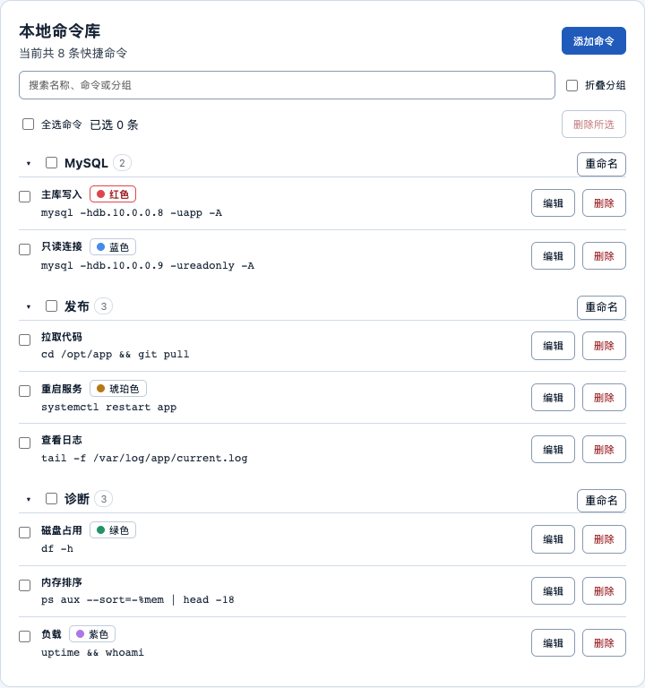

# sshpad

JumpServer 终端上的分组快捷命令栏。

给 [JumpServer](https://www.jumpserver.org/) 的 Luna Web 终端加一条**分组快捷命令栏**。
点一下按钮，命令就提交到当前 SSH 会话——不用再从备忘里复制粘贴。

[](https://github.com/penn0312/sshpad/actions/workflows/ci.yml)
[](LICENSE)

> 一个 Chrome 扩展（Manifest V3）：无构建、无依赖、无网络请求。
> 适配 Luna / KoKo **v4.10.21**。


---

## 为什么

跳板机上重复输入的是同一批命令：连数据库、tail 日志、cd 到项目目录、重启服务。
把 SecureCRT 时代的按钮栏搬到 Web 终端，最直接的收益是**少打几百次键盘**。

但快捷命令的危险在于：**它会替你在生产 shell 里按下回车**。所以 sshpad 的第一原则是
「宁可停用，也不发错机器」——每一次提交前后都会核对当前终端是不是你看着的那一个。

## 特性

- **一眼看全**：分组平铺、自动换行、分组带色标签，首行排满不留空。
- **只发给对的机器**：提交前后各采样一次会话标识（iframe / sessionId / terminalId），
  不一致就拒绝；分屏、断开、跨源终端直接停用并说明原因。
- **按站点隔离**：可同时接入多套 JumpServer，每个站点单独选择显示哪些分组。
- **导入不覆盖本地**：命令库支持 JSON 导入，本地改过的名称、颜色、删除记录不会被下次导入冲掉。
- **危险命令点两次**：命令里带明文密码或令牌时按钮标记黄条，需要再点一次确认。
- **找得快**：按 `/` 聚焦筛选框，按名称、命令内容或分组过滤。
- **轻**：没有轮询，Service Worker 正常休眠；页面状态由事件驱动，稳态零 IPC。

## 安装

1. 打开 `chrome://extensions`，开启「开发者模式」，点「加载未打包的扩展程序」，选择本仓库的 `extension/` 目录。
2. 点扩展图标打开设置，填入站点源地址（例如 `https://jump.example.com`，可带端口），
   点「添加或授权站点」，在 Chrome 提示中确认。
3. 打开或刷新该站点的 Luna 页面，终端底部出现命令栏。

> 首次安装后**必须刷新 Luna 页面**：脚本是在页面加载时注入的。

想先看看效果：设置页「本地命令库」为空时点「用示例命令库试用」。

## 使用

### 命令栏

| 操作 | 说明 |
| --- | --- |
| 单击按钮 | 提交该命令，并把焦点交回终端 |
| 悬停 | 查看完整命令 |
| 按 `/` 或点 `/` 图标 | 展开筛选框；`Esc` 清空并收起 |
| `⚙` 图标 | 打开设置页 |

命令栏只在**当前标签恰好一个已连接、且允许发送**的 KoKo SSH 窗格时启用。
分屏、断开、多终端或无法识别目标时按钮禁用，状态行说明原因。

### 命令模式

| 模式 | 行为 |
| --- | --- |
| 自动识别（默认） | 没有引号且出现 `\n\p` 时按发送字符串处理，否则当单行命令 |
| 单行命令 | 原样提交一行，可以写 `pwd && whoami` 这样的命令链 |
| 发送字符串 | `\n`/`\r` 回车、`\p` 暂停一秒、`\\` 表示反斜杠，例如 `sudo git pull\n\pusername` |

交互式命令（如 `sudo git pull`）只需保存命令本身，等提示出现后自己输入密码。

### 设置页

- 多站点授权，逐站点选择显示哪些分组
- 添加 / 编辑 / 删除命令，批量选择删除，给按钮选颜色
- 分组重命名、折叠，按名称或命令内容搜索
- 导入 JSON 前先预览新增、删除、修改与顺序变化



## 命令库 JSON

格式说明见 [`docs/command-library.md`](docs/command-library.md)。最小示例：

```json
{
  "version": 1,
  "sourceId": "example-team",
  "groups": [
    {
      "id": "shell-basics",
      "name": "Shell basics",
      "commands": [
        { "id": "working-directory", "name": "Working directory", "command": "pwd" },
        { "id": "current-user", "name": "Current user", "command": "whoami" }
      ]
    }
  ]
}
```

保持 `sourceId`、分组 ID 和命令 ID 稳定，重新导入时站点的分组选择和本地修改才会保留。

## 从 SecureCRT 迁移

macOS、Python 3.9+ 标准库，只读解析 SecureCRT 的 `ButtonBarV5.ini` 与 `Commands/`：

```bash
python3 scripts/sync_securecrt.py --dry-run
python3 scripts/sync_securecrt.py --output "$HOME/Downloads/securecrt-commands.json"
```

然后在设置页导入该文件。详见 [`docs/import-securecrt.md`](docs/import-securecrt.md)。

## 安全说明

命令栏会替你在 shell 里按回车，所以有几条硬规则：

- 只在**显式授权**的站点运行，按站点动态注册内容脚本
- 提交走与 Luna 自身相同的 `CMD` 消息，KoKo 仍会执行会话权限与剪贴板 ACL
- 命令正文不接受控制字符和换行，单行提交
- 命令正文**以明文保存在扩展本地存储中**；凭据检测只是提示，不是保险

**不要把生产密码写进快捷命令。** 需要密码时让命令停在提示处手动输入，
或使用 `-p` 让工具自己提示。更多见 [SECURITY.md](SECURITY.md)。

## 开发

需要 Node.js 20+、Python 3.9+、Chromium。

```bash
npm ci
npx playwright install chromium
npm test          # 单元 + 端到端 + 导出脚本
npm run package   # 生成 dist/sshpad-<version>.zip
```

| 命令 | 覆盖 |
| --- | --- |
| `npm run test:unit` | 命令库视图、筛选、状态文案、凭据识别与脱敏 |
| `npm run test:python` | SecureCRT INI 解析、转义、冲突、原子写 |
| `npm run test:e2e` | 真实 Chromium 加载未打包扩展，跑授权、导入、执行、竞态、布局不变量等场景 |

浏览器测试使用本地虚构的 Luna / KoKo 页面（`tests/*-fixture.html`），**不需要真实 JumpServer**。

### 代码结构

| 路径 | 作用 |
| --- | --- |
| `extension/worker.js` | Service Worker：站点授权、注册脚本、消息路由、执行调度 |
| `extension/probe.js` | **MAIN world** 探针：事件驱动地判断「当前是哪个终端、是否可用」 |
| `extension/bar.js` | 命令栏 UI（无 import 的普通脚本，样式隔离在 Shadow DOM） |
| `extension/luna.js` | 提交动作，执行前向探针复核会话标识 |
| `extension/library.js` | 数据模型、JSON 校验、导入 diff、站点分组过滤 |
| `extension/catalog.js` | 命令栏视图数据（纯函数，可单测） |
| `extension/sensitive.js` | 明文凭据识别与脱敏 |
| `extension/send-string.js` | `\n` / `\p` 发送字符串解析 |

**要适配新版 JumpServer，通常只需要改 `extension/probe.js`**：
上游的 DOM 选择器和 Vue 状态结构都收敛在那一个文件里。

## 兼容性与已知限制

- 只适配 Luna / KoKo **v4.10.21** 的主终端页。
- 页面状态探测依赖 KoKo 暴露的 Vue Pinia 状态。上游改名或重构后可能失效；
  失效时会**停用而不是误发**，并在状态行说明原因。
- 命令正文以明文保存在扩展本地存储中（见上文安全说明）。
- 尚未在真实 JumpServer 实例上验证执行回显，现有测试全部基于虚构夹具。

## 贡献

欢迎 issue 和 PR。改动 `probe.js` 的探测逻辑时，请一并补充对应的测试夹具场景——
那是最容易随上游版本一起坏掉的部分。

## 许可证

[MIT](LICENSE)。安全问题请通过仓库 Security advisory 私下报告。

版本变更见 [CHANGELOG.md](CHANGELOG.md)。